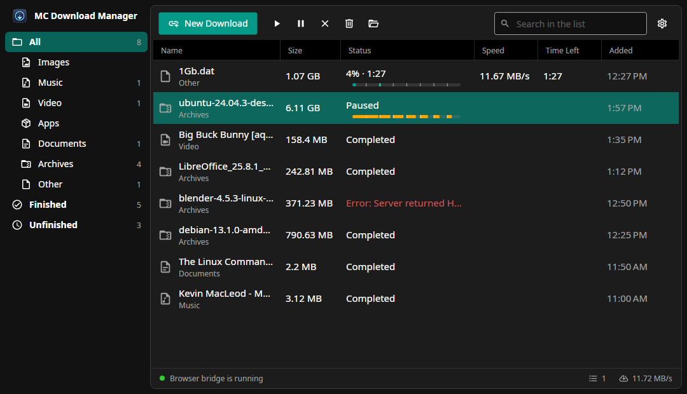
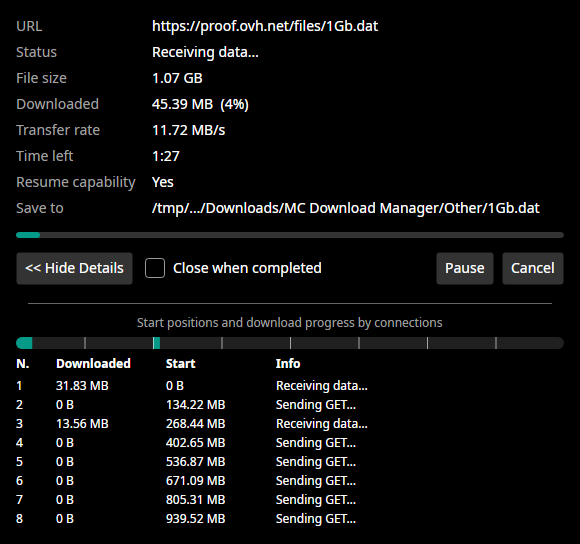

<p align="center">
  
</p>

<h1 align="center">MC Download Manager for Linux</h1>

<p align="center">
  Linux masaüstleri için açık kaynaklı bir indirme yöneticisi.<br>
  Chrome, Chromium, Brave ve Edge indirmelerini devralır, 16'ya kadar paralel bağlantıyla hızlandırır ve web sayfalarındaki videoları yt-dlp ile indirir.
</p>

<p align="center">
  <a href="README.md">🇬🇧 English</a> · <a href="#derleme-ve-çalıştırma">Derleme</a> · <a href="#tarayıcı-eklentisi">Tarayıcı eklentisi</a> · <a href="#upstream-ile-güncel-kalmak">Upstream ile eşitleme</a>
</p>

<p align="center">
  
</p>

---

Bu, **MC Download Manager**'ın Linux sürümüdür. Uygulama bir dizi uyarlamadan geliyor:

1. [mstcvk/mc-download-manager](https://github.com/mstcvk/mc-download-manager): Mesut Çevik'in özgün macOS uygulaması (Swift).
2. [azadkarakus/mc-download-manager-windows](https://github.com/azadkarakus/mc-download-manager-windows): Windows için C# / WPF uyarlaması.
3. Bu depo: Windows uyarlamasının C# motorunu, [Avalonia](https://avaloniaui.net/) arayüzüyle Linux'ta çalıştırır.

İndirme motoru, tarayıcı köprüsü ve tarayıcı eklentisi **yeniden yazılmadı**: doğrudan Windows uyarlamasının kaynak dosyalarından derlenir.
Böylece oradaki düzeltmeler bu uygulamaya bir `git merge` ile gelir. Yalnızca arayüz ve birkaç işletim sistemi çağrısı Linux'a özgüdür.

Arayüz **Türkçe** ve **İngilizce**dir (`LANG` değişkenine göre seçilir) ve sistemin açık/koyu temasını izler.

> **Durum:** erken aşama. CachyOS (Arch) üzerinde, Wayland'de KDE Plasma 6 ve Chrome ile test edildi.
> Diğer dağıtımlarda ve masaüstlerinde de çalışması beklenir ama henüz denenmedi. Hazır paketler (AppImage, AUR) planlanıyor; şimdilik [kaynaktan derleyin](#derleme-ve-çalıştırma).

## Özellikler

- **Çok bağlantılı indirme**: dosyalar HTTP `Range` isteklerine bölünür (varsayılan 8 bağlantı, 1–16 arası ayarlanabilir).
  Sunucu `Range` desteklemiyorsa tek akışa geçer, `429`/`503` sınırlamalarında bekleyip yeniden dener.
- **Duraklat ve devam et**: her parçanın durumu diske kaydedilir; indirmeler yeniden başlatmadan sonra bile kaldığı yerden sürer.
- **Tarayıcı entegrasyonu**: tarayıcının indirmesi iptal edilir ve çerezler, `Referer` ve `User-Agent` ile birlikte uygulamaya aktarılır.
  Hangi dosya türlerinin yakalanacağı ayarlanabilir.
- **Video indirme**: eklentideki "Bu sayfadaki videoyu indir" seçeneği yt-dlp'yi kullanır; görüntü ve ses ffmpeg ile birleştirilir.
  Varsayılan çıktı 1080p'ye kadar MP4'tür; kapsayıcı ve kalite ayarlanabilir.
- **Pano**: bir dosya bağlantısını kopyaladığınızda uygulama indirilsin mi diye sorar. Ana pencerede `Ctrl+V` bağlantıları yapıştırır, `Ctrl+N` yeni indirme ekler.
- **İndirme penceresi**: her indirme için ayrıntılar, parça çubuğu ve her bağlantının durumu; videolarda yt-dlp çıktısı.

  

- **Linux masaüstü entegrasyonu**:
  - sistem tepsisi simgesi (StatusNotifierItem); pencere kapatılınca uygulama çalışmaya devam eder
  - "Klasörde Göster" düğmeli masaüstü bildirimleri
  - "Klasörde Göster", dosyayı Dolphin, Nautilus, Nemo ve `org.freedesktop.FileManager1` destekleyen diğer dosya yöneticilerinde seçili açar
  - "Kaldır ve Dosyayı Sil" dosyayı Çöp Kutusu'na taşır
  - XDG autostart kaydıyla isteğe bağlı oturum açılışında başlatma
  - ikinci kez açmak, çalışan uygulamanın penceresini öne getirir

## Gereksinimler

| | Gerekli olduğu iş | Arch / CachyOS | Debian / Ubuntu | Fedora |
|---|---|---|---|---|
| [.NET 10 SDK](https://dotnet.microsoft.com/download) | derleme | `dotnet-sdk` | [Microsoft'un talimatları](https://learn.microsoft.com/dotnet/core/install/linux) | `dotnet-sdk-10.0` |
| yt-dlp, ffmpeg | video indirme | `yt-dlp ffmpeg` | `yt-dlp ffmpeg` | `yt-dlp ffmpeg` |
| deno | YouTube videoları | `deno` | [deno.com](https://docs.deno.com/runtime/getting_started/installation/) | [deno.com](https://docs.deno.com/runtime/getting_started/installation/) |
| `notify-send` | bildirimler | `libnotify` | `libnotify-bin` | `libnotify` |
| `gio` veya `kioclient` | dosyaları Çöp Kutusu'na taşıma | `glib2` veya `kio` | `libglib2.0-bin` | `glib2` |

Sistem tepsisi olan bir masaüstü önerilir (KDE Plasma, XFCE, Cinnamon ya da *AppIndicator* eklentili GNOME),
çünkü pencereyi kapatmak uygulamayı tepside çalışır halde bırakır.

Windows sürümünden farklı olarak uygulama yt-dlp, ffmpeg ve deno'yu kendisi indirmez; bunları paket yöneticinizle kurun.
Uygulama onları `PATH` üzerinde bulur; *Ayarlar ▸ Video* hangi sürümleri bulduğunu gösterir.

## Derleme ve çalıştırma

```bash
git clone https://github.com/okolyigit/mc-download-manager-linux.git
cd mc-download-manager-linux/linux

dotnet run --project MCDownloadManager.Linux     # derle ve uygulamayı başlat
dotnet run --project Tests                       # motor ve köprü öz denetimi
```

.NET kurulu olmadan çalışan bağımsız bir kopya derlemek için:

```bash
dotnet publish MCDownloadManager.Linux -c Release -r linux-x64 --self-contained -o ~/.local/opt/mc-download-manager
~/.local/opt/mc-download-manager/mc-download-manager
```

Uygulama menüsüne eklemek için `~/.local/share/applications/mc-download-manager.desktop` dosyasını oluşturun:

```ini
[Desktop Entry]
Type=Application
Name=MC Download Manager
Comment=Tarayıcı entegrasyonlu indirme yöneticisi
Exec=/home/KULLANICI_ADINIZ/.local/opt/mc-download-manager/mc-download-manager
Icon=folder-download
Categories=Network;FileTransfer;
```

`KULLANICI_ADINIZ` yerine kendi kullanıcı adınızı yazın. Uygulama ilk açılışta oturum açılınca başlatılıp başlatılmayacağını sorar.

## Tarayıcı eklentisi

Uygulama her açılışta tarayıcı eklentisini `~/.local/share/MC Download Manager/BrowserExtension` klasörüne kopyalar
(*Ayarlar ▸ Tarayıcı* klasörü gösterir ve *Klasörü Aç* düğmesi sunar).

**Chrome, Chromium, Brave, Edge**

1. `chrome://extensions` adresini açın.
2. *Geliştirici modu*nu açın.
3. *Paketlenmemiş öğe yükle*ye tıklayıp yukarıdaki klasörü seçin. Klasör gizlidir: dosya penceresinde `Ctrl+H` ile gösterebilirsiniz.

Uygulama açıkken (tepside durabilir) bir dosya indirin: indirme tarayıcıdan uygulamaya geçer.
Eklentinin açılır penceresi uygulamaya ulaşıp ulaşamadığını gösterir.

**Firefox** Linux'ta henüz denenmedi. Eklenti upstream'deki ile aynıdır; [upstream talimatlarına](../README.tr.md) bakın.

## Dosyaların yeri

| Yol | İçerik |
|---|---|
| `~/Downloads/MC Download Manager/` | indirilen dosyalar, kategori klasörlerine ayrılmış (*Ayarlar*'dan değiştirilebilir) |
| `~/.local/share/MC Download Manager/settings.json` | ayarlar |
| `~/.local/share/MC Download Manager/downloads.json` | indirme listesi ve devam ettirmek için parça durumu |
| `~/.local/share/MC Download Manager/cookies/` | eklentinin video indirmeleri için aktardığı çerezler |
| `~/.local/share/MC Download Manager/BrowserExtension/` | tarayıcı eklentisi, her açılışta yenilenir |
| `~/.config/autostart/mc-download-manager.desktop` | yalnızca *Oturum açılınca başlat* açıksa |

Bitmemiş indirmeler hedef klasörde gizli `.dm-<id>.part` dosyaları olarak tutulur.

## Güvenlik

- Köprü yalnızca `127.0.0.1:48213` adresini dinler ve yalnızca tarayıcı eklentisi kaynaklarına (`chrome-extension://`, `moz-extension://`)
  loopback `Host` ile yanıt verir. Sıradan web sayfalarından gelen istekler, `Origin: null` dahil, reddedilir.
- Çerezler ve `Authorization` yalnızca indirmenin başlatıldığı sunucuya gönderilir; yönlendirmeyle ulaşılan başka bir sunucuya asla gönderilmez.
- İndirilen dosyalara, Chrome ve Firefox'un Linux'ta yaptığı gibi `user.xdg.origin.url` ve `user.xdg.referrer.url` öznitelikleri eklenir.
- Dosya adları Linux'ta da Windows kurallarıyla temizlenir; böylece indirmeler NTFS veya exFAT disklere hatasız kopyalanabilir.

## Nasıl yapılandırıldı

```
linux/
  MCDM.Core/                     sınıf kütüphanesi: upstream'in motor dosyaları, yerinde derlenir
    Compat/WpfDispatcher.cs      motorun kullandığı WPF Dispatcher parçası, Avalonia üzerinde
    Platform.Linux.cs            dosya yöneticisi, Çöp Kutusu, xattr, MIME türleri
  MCDownloadManager.Linux/       Avalonia uygulaması
    App.axaml(.cs)               tepsi simgesi, pano, bildirimler, tek örnek
    MainWindow.axaml(.cs)        kenar çubuğu, liste, araç çubuğu, durum çubuğu
    DetailWindow.cs              indirme penceresi
    SettingsWindow.cs            ayarlar
    LinuxDesktop.cs              tek örnek soketi, autostart kaydı, notify-send
  Tests/                         upstream'in Tests/Program.cs dosyasını MCDM.Core'a karşı çalıştırır

MCDownloadManager/               upstream'in Windows uygulaması; motor dosyaları ortak kullanılır
Extension/                       upstream'in tarayıcı eklentisi (Manifest V3), değiştirilmeden kullanılır
```

`MCDM.Core` şu upstream dosyalarını kopyalamadan derler:
`Models.cs`, `SegmentedDownloader.cs`, `DownloadStore.cs`, `BridgeServer.cs` ve `Tools.cs`.
Bunlardaki birkaç Windows çağrısı (Explorer, Geri Dönüşüm Kutusu, kayıt defteri, `Zone.Identifier`) küçük bir `Platform` sınıfından geçer:
upstream'in Windows uygulamasında `MCDownloadManager/Platform.Windows.cs`, bu uygulamada `linux/MCDM.Core/Platform.Linux.cs` bulunur.

## Upstream ile güncel kalmak

`main` dalı upstream'in tüm geçmişini içerir.

```bash
git remote add upstream https://github.com/azadkarakus/mc-download-manager-windows.git
git fetch upstream
git merge upstream/main

cd linux
dotnet run --project Tests                       # ALL PASSED yazmalı
dotnet build MCDownloadManager.Linux
```

Upstream'in motor dosyalarındaki değişiklikler birleştirmeyle gelir.
Çakışma yalnızca bu deponun upstream dosyalarında değiştirdiği birkaç satırda çıkabilir (`Move Windows-specific calls behind a Platform class` commit'ine bakın).

Ortak dosyaların Windows için hâlâ derlendiğini görmek için upstream'in uygulamasını Linux'tan derleyin:

```bash
dotnet build MCDownloadManager -p:EnableWindowsTargeting=true
```

Özgün macOS uygulaması ([mstcvk/mc-download-manager](https://github.com/mstcvk/mc-download-manager)) yeni özellikleri, örneğin eklenti güncellemelerini, genellikle ilk alır.
Bunlar Windows uyarlamasına ulaştığında bu uygulamaya da gelir ya da doğrudan buraya uyarlanabilir.

## Katkı

Hata bildirimleri ve pull request'ler memnuniyetle karşılanır. Pull request göndermeden önce öz denetimi çalıştırın (`dotnet run --project linux/Tests`).

- Linux'a özgü değişiklikler `linux/` klasörüne aittir.
- İndirme motoru, köprü veya eklentiyle ilgili düzeltmeleri [Windows uyarlamasına](https://github.com/azadkarakus/mc-download-manager-windows) göndermek daha iyidir;
  böylece tüm sürümler yararlanır ve bu depo onları bir sonraki birleştirmede alır.
- Arayüz metinleri İngilizce ve Türkçedir: `S.T("English", "Türkçe")`.

## Emeği geçenler ve lisans

- [Mesut Çevik](https://github.com/mstcvk): özgün macOS uygulaması, tarayıcı eklentisi ve köprü API'si.
- [azadkarakus](https://github.com/azadkarakus): motoru bu uygulamada çalışan Windows uyarlaması.
- Linux uyarlaması: Özcan KOLYİĞİT.

MIT Lisansı ile lisanslanmıştır, bkz. [LICENSE](../LICENSE).
yt-dlp (Unlicense), FFmpeg (LGPL/GPL) ve deno (MIT) kullanıcının kurduğu ayrı programlardır; bu deponun parçası değildir.
Simgeler: [Material Design Icons](https://pictogrammers.com/library/mdi/) (Apache 2.0), [Material.Icons.Avalonia](https://github.com/SKProCH/Material.Icons) (MIT) aracılığıyla.
